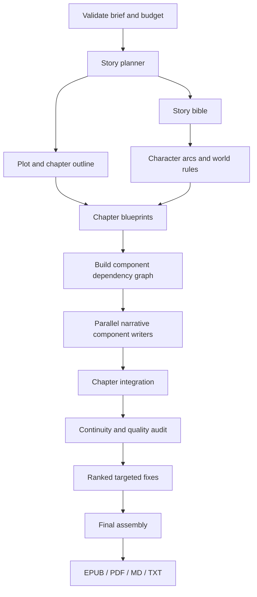

### Build-ready specification: Groq Book Studio

The product decisions are sufficiently complete. We should now stop asking broad preference questions and lock the implementation contract.

The prototype is a local-first, single-file HTML application that takes an original story brief and produces a coherent, formatted 15,000-word novella using configurable Groq models and asynchronous specialist agents, while keeping estimated API spending within $2.

Two constraints will shape the implementation:

* Cost control is a scheduling problem. Concurrent requests, retries, and unfinished tasks must all count toward the budget. The app must protect $0.70 for editing and final assembly.

* Narrative consistency is a dependency problem. Character arcs, twists, and subplots should be planned together, assigned to chapters, and generated according to explicit dependencies rather than thrown into a parallel-request blender.

### 1\. Remaining critical implementation decisions

Only a few technical choices still need to be fixed. These can be implementation defaults rather than another round of product discovery.

| Decision           | Recommended default                                                     | Why                                                                               |
| ------------------ | ----------------------------------------------------------------------- | --------------------------------------------------------------------------------- |
| Runtime            | One self-contained HTML file with inline CSS and JavaScript             | Simple to inspect, save, and run locally                                          |
| API access         | Direct browser requests to Groq's documented API                        | Avoids requiring a backend; verify browser CORS support for the selected endpoint |
| Persistence        | IndexedDB for project state; local storage for the API key              | More suitable for large manuscripts and task histories                            |
| Cost source        | Configurable model pricing, reconciled with API-reported usage          | Token counts alone do not establish monetary cost                                 |
| Concurrency        | Dependency-aware queue with a global cap and per-model caps             | Respects independent model quotas                                                 |
| Structured outputs | JSON contracts, schema validation, bounded repair attempts              | Prevents malformed agent results from breaking the pipeline                       |
| Exports            | Client-side Markdown/TXT generation, EPUB packaging, and PDF generation | Keeps the prototype serverless                                                    |
| Resume semantics   | Persist every completed task before scheduling dependent work           | Avoids rerunning successful requests after interruption                           |

Critical caveat: a browser-only app cannot guarantee an exact $2 ceiling when several paid requests are already in flight. It can enforce a conservative estimated ceiling by reserving the maximum configured cost of every request before dispatch. API usage and provider billing should be reconciled after each response.

Direct browser access must be tested against Groq's actual API behavior. If browser requests are not supported in the chosen configuration, the fallback is a tiny local proxy, but that would no longer be a strictly single-file application.

### 2\. Product requirements and acceptance criteria

One-file application

A standalone `groq-book-studio.html` containing the interface and application logic. No build step or mandatory backend.

Budget guard

$2 total budget, $1.30 planning/drafting envelope, $0.70 protected editing/finalization reserve. Editable model pricing and conservative in-flight reservations.

Asynchronous agent scheduler

Dependency-aware execution, multiple concurrent requests, per-model rate limits, retries, fallback models, and safe pause/resume.

Narrative pipeline

A fixed 15,000-word target, story bible, chapter blueprints, narrative components, continuity tracking, quality scoring, and targeted revisions.

Portable projects and exports

Autosave, JSON project state, ZIP snapshots, EPUB, PDF, Markdown, and TXT.

### Acceptance criteria

The prototype is successful when it can:

* Validate an API key and submit a test completion using a manually selected model.

* Run several independent tasks concurrently while respecting configured concurrency and quota limits.

* Record estimated input/output tokens, actual returned usage, model, latency, retries, task status, and estimated spend.

* Refuse to launch work when its conservative cost reservation would violate the applicable budget envelope.

* Generate a small test story from an original brief, with explicit dependencies between planning, drafting, editing, and assembly.

* Resume a saved project without regenerating completed tasks unnecessarily.

* Produce readable exports with chapter headings, metadata, and navigation where supported.

* Pause safely on budget exhaustion or unrecoverable failures without discarding completed work.

### 3\. Application interface

Use six main panels in a single-page layout.

A. Setup

API key, connection test, model list, model IDs, and per-agent model assignments.

B. Story brief

Premise, characters, setting, conflict, desired ending, genre, tone, POV, tense, audience, and must-have plot points.

C. Pipeline configuration

Chapter count, word targets, agent settings, JSON editor, dependency graph, retry policy, concurrency, and per-model quotas.

D. Run dashboard

Current stage, completed tasks, overall progress, estimated spend, actual usage, remaining budget, and editing reserve.

E. Manuscript

Story bible, chapter list, generated prose, unresolved continuity issues, and quality scores.

F. Save and export

Save project, import JSON, export ZIP snapshot, and select EPUB/PDF/Markdown/TXT.

The dashboard should remain simple by default. Detailed request logs and raw JSON belong in expandable task details, not in the main progress view.

### 4\. Agent architecture and dependency graph

Use a directed acyclic graph (DAG) of tasks. Each task has a stable ID, input references, dependencies, assigned model, token limits, retry policy, output schema, and status.



### Agent contracts

| Agent              | Input                                       | Required output                                              |
| ------------------ | ------------------------------------------- | ------------------------------------------------------------ |
| Planner            | Story brief and style constraints           | Plot structure, stakes, resolution, themes                   |
| Story-bible agent  | Planner output                              | Canonical characters, setting rules, timeline, relationships |
| Outline agent      | Plot and story bible                        | Chapter goals, word budgets, turning points                  |
| Component writers  | Component brief and relevant canon          | Scene, arc, subplot, exposition, or twist material           |
| Integrator         | Completed components and chapter blueprint  | Ordered, readable chapter prose                              |
| Continuity auditor | Manuscript, bible, timeline, subplot ledger | Ranked issues with evidence and locations                    |
| Editor             | Ranked issues and relevant passages         | Minimal targeted changes, not a full rewrite                 |
| Assembler          | Approved chapters and metadata              | Canonical manuscript and export-ready structure              |

Do not run dependent tasks prematurely. For example, a reveal that depends on a character's secret must wait until the secret and its intended reveal point are defined in the outline.

Each component should declare whether it is required, optional, or conditionally enabled. The system should not force every novel to contain a separate twist or subplot merely because a generic template lists one.

### 5\. JSON configuration contract

The JSON configuration is the source of truth for model assignments, task definitions, and limits. Visual controls should edit this same configuration, not maintain a separate hidden copy.

Here is the initial configuration format. Prices and quota values are deliberately placeholders until the user supplies the current values for their own account and selected models.

```json

{
  "version": 1,
  "project": {
    "title": "Untitled Novella",
    "target_words": 15000,
    "chapter_count": 12,
    "word_count_tolerance": 0.10,
    "currency": "USD"
  },
  "budget": {
    "total_usd": 2.00,
    "drafting_usd": 1.30,
    "reserve_usd": 0.70,
    "safety_margin": 0.20,
    "on_exhaustion": "pause"
  },
  "scheduler": {
    "max_concurrent": 4,
    "per_model_concurrency": 2,
    "respect_dependencies": true,
    "retry_max": 3,
    "backoff_base_ms": 1000,
    "fallback_on_failure": true
  },
  "models": {
    "writer-model": {
      "model_id": "REPLACE_WITH_ACTIVE_GROQ_MODEL_ID",
      "input_usd_per_million": 0,
      "output_usd_per_million": 0,
      "context_window_tokens": 0,
      "max_completion_tokens": 0,
      "limits": {
        "rpm": 0,
        "rpd": 0,
        "tpm": 0,
        "tpd": 0,
        "itpm": null,
        "otpm": null,
        "concurrency": 2
      },
      "safety_margin": 0.20
    }
  },
  "agents": {
    "planner": {
      "model": "writer-model",
      "temperature": 0.5,
      "max_output_tokens": 2500,
      "fallback_model": null
    },
    "component_writer": {
      "model": "writer-model",
      "temperature": 0.8,
      "max_output_tokens": 2500,
      "fallback_model": null
    },
    "continuity_auditor": {
      "model": "writer-model",
      "temperature": 0.2,
      "max_output_tokens": 1500,
      "fallback_model": null
    },
    "editor": {
      "model": "writer-model",
      "temperature": 0.4,
      "max_output_tokens": 2500,
      "fallback_model": null
    }
  },
  "quality": {
    "minimum_score": 3,
    "scale": 5,
    "revision_policy": "ranked_fixes",
    "max_revision_rounds": 1
  },
  "persistence": {
    "autosave": true,
    "exclude_api_key_from_exports": true
  }
}
```

### Configuration validation rules

* Reject unknown model aliases, invalid dependency references, cycles in the task graph, negative prices, and invalid token limits.

* Warn when a model's configured context window or completion limit is inconsistent with its current API metadata.

* Require explicit model assignments for every enabled agent.

* Never treat a zero price as a verified free model. It means price not configured and should block paid-run preflight until resolved.

* If the selected model's limits cannot be verified, require manually entered limits and clearly mark them as user-supplied.

* Version the configuration and provide a migration function when the schema changes.

Groq exposes an API endpoint for listing available model IDs, and its documentation describes the chat-completions interface. The app should use these sources for model discovery and request compatibility, while keeping price and account-specific quotas editable.

### 6\. Budget accounting and request scheduler

This is the most important non-writing subsystem.

### Cost formula

For a model with known per-million-token prices:

C_{\\text{request}} =
\\frac{T_{\\text{in}}P_{\\text{in}}+
T_{\\text{out}}P_{\\text{out}}}{10^6}

Where:

* is the estimated or reported input-token usage.

* is the estimated or reported output-token usage.

* and are the model's input and output prices per million tokens.

Track these separately:

* `actual_spend`: cost calculated from returned usage and configured pricing.

* `reserved_spend`: maximum estimated cost committed to running requests.

* `available_to_dispatch`: remaining spend after actual costs and active reservations.

* `drafting_available`: remaining spend in the $1.30 drafting envelope.

* `reserve_available`: remaining spend in the $0.70 finalization envelope.

Dispatch rule: a request may start only if its maximum configured output cost plus conservative input estimate fits inside the permitted envelope after accounting for all outstanding reservations.

If an API request fails after dispatch, the app must not automatically assume it cost nothing. Record returned usage if available; otherwise flag the cost as uncertain and apply the configured conservative accounting policy.

### Scheduler algorithm

```javascript

async function schedulerStep(project) {
  // 1. Persist the current state before dispatch.
  await saveProject(project);

  // 2. Find tasks whose dependencies are all complete.
  const ready = getReadyTasks(project);

  // 3. Respect global and per-model concurrency.
  for (const task of ready) {
    if (!hasConcurrencyCapacity(project, task)) continue;

    // 4. Estimate the maximum cost, including output tokens.
    const estimate = estimateRequestCost(project, task);

    // 5. Check the correct budget envelope and reserve.
    if (!canReserveBudget(project, task, estimate)) {
      pauseProject(project, "Budget reservation denied");
      break;
    }

    // 6. Check RPM, TPM, daily quotas, and safety margins.
    if (!canDispatchWithinQuotas(project, task, estimate)) continue;

    // 7. Reserve budget and quota capacity before dispatch.
    reserveRequest(project, task, estimate);
    await saveProject(project);

    // 8. Dispatch without blocking unrelated ready tasks.
    dispatchTask(project, task);
  }
}
```

This is illustrative pseudocode, not a complete scheduler implementation. Production code must handle completion callbacks, cancellation, persistent locks, and reconciliation before releasing reservations.

Groq documents RPM, RPD, TPM, TPD, and optional separate input/output token limits, with `429` responses for exceeded limits and rate-limit headers that can inform scheduling. The scheduler should support these dimensions rather than treating concurrency as a substitute for quotas.

### Retry and fallback policy

* Retry transient network errors, timeouts, and rate-limit responses with exponential backoff and jitter.

* Honor `Retry-After` when provided.

* Do not blindly retry invalid API keys, malformed requests, or unsupported model IDs.

* If retries fail, attempt the explicitly configured fallback model only after checking its price, quota, context, and output limits.

* Record each attempt independently, including its cost and result.

* Never silently switch to a different model or exceed the budget to complete a task.

A fallback is a configured alternative, not permission to select an arbitrary cheap model.

### 7\. Narrative generation and context retrieval

The pipeline should use structured data internally, not treat the entire project as a growing wall of text.

### Canonical story state

The story bible should contain:

* Characters: goals, fears, beliefs, relationships, secrets, voice, and arc milestones.

* World rules: locations, chronology, constraints, and established facts.

* Plot: causal events, promises made to the reader, setup/payoff links, and the planned resolution.

* Subplots: owner characters, introduction, turning points, resolution, and dependencies.

* Continuity ledger: established facts, changes, contradictions, and unresolved questions.

* Chapter state: target word count, narrative purpose, components, completed scenes, and outstanding issues.

### Component output contract

Every component writer should return structured data with:

* A stable component ID and assigned chapter.

* Its narrative purpose and prerequisites.

* The characters and subplot threads it advances.

* The generated prose.

* New facts introduced into the story.

* Required setup or payoff links.

* Any unresolved dependencies or assumptions.

The orchestrator should validate the result before marking the task complete. If an output fails validation, retry or repair it within a bounded budget.

### Retrieval rules

Before a component is written, retrieve:

* The relevant chapter blueprint.

* Relevant story-bible entries.

* The most recent states of the involved characters and subplots.

* Earlier scenes required by its dependencies.

* The global style guide and any applicable narrative constraints.

Avoid including the whole manuscript in every prompt. This reduces repeated input-token costs and limits irrelevant context.

### Quality rubric

Use a 1-to-5 score for each dimension:

| Dimension          | What the auditor checks                                                         |
| ------------------ | ------------------------------------------------------------------------------- |
| Causality          | Do events follow from earlier decisions and established facts?                  |
| Character arcs     | Do choices and changes follow believable motivations?                           |
| Subplot resolution | Are important threads developed and paid off?                                   |
| Pacing             | Do scenes advance the story without unnecessary repetition?                     |
| Style consistency  | Are POV, tense, tone, and character voices stable?                              |
| Thematic depth     | Are themes developed through events and choices rather than just explained?     |
| Ending             | Does the resolution address the main conflict and fulfill the story's promises? |

The auditor should return evidence and location, not merely scores. For example: “The protagonist's fear of abandonment is resolved in Chapter 4, but Chapters 8 and 9 still treat it as unchanged.”

The revision planner then ranks defects by severity, dependency impact, and estimated repair cost. It should prioritize contradictions and broken plot logic over stylistic polishing. A single targeted revision round is the default; the system pauses when the reserve is insufficient.

### 8\. Persistence, security, and recovery

Use IndexedDB for the project database and local storage only for the API key, as requested.

Suggested entities:

```text
Project
  id, schemaVersion, settings, brief, storyBible, metadata

Task
  id, type, status, dependencies, modelId, inputs, output, attempts

Chapter
  id, number, blueprint, componentIds, canonicalContent, wordCount

UsageRecord
  id, taskId, attempt, modelId, inputTokens, outputTokens
  estimatedCost, reportedUsage, status, timestamp

ContinuityIssue
  id, severity, chapterId, evidence, proposedFix, status

ProjectSnapshot
  id, timestamp, schemaVersion, exportedFiles
```

### Recovery guarantees

* Save task state before and after every network request.

* Persist each successful output before unblocking dependent tasks.

* Use stable task IDs and request fingerprints to avoid duplicate scheduling after a reload.

* On import, validate the schema and dependency graph before resuming.

* Treat a request interrupted by browser closure as unknown, not automatically failed or successful.

* Never promise exactly-once billing: a browser may lose the response after the provider has processed a request.

### API key handling

A browser-held API key is accessible to scripts running in the page and may be exposed by malicious extensions, injected scripts, or unsafe third-party libraries. Local storage is convenience, not secure secret storage.

For the prototype:

* Never include the key in project JSON, ZIP backups, logs, exports, or error messages.

* Provide a clear “forget key” control.

* Avoid remote scripts and unnecessary third-party dependencies.

* Do not deploy the file as a public website with a personal key stored in the browser.

* Document the option to use a local backend proxy if the app later needs stronger credential isolation.

### 9\. Export implementation

Keep structured chapter data as the canonical manuscript, then render it into the four requested formats.

| Format   | Implementation               | Required checks                                           |
| -------- | ---------------------------- | --------------------------------------------------------- |
| Markdown | Native JavaScript renderer   | Headings, metadata, chapter breaks, UTF-8                 |
| TXT      | Plain-text renderer          | Correct chapter order, no markup artifacts                |
| EPUB     | Client-side ZIP/EPUB library | Valid EPUB structure, navigation, metadata, chapter XHTML |
| PDF      | Client-side PDF library      | Page breaks, readable typography, headers, page numbers   |

Recommended export details:

* Title page with title, author, and optional date.

* Table of contents with working chapter links where supported.

* Consistent chapter titles and typography.

* Unicode-safe rendering.

* Explicit word count and manuscript version in export metadata.

* A validation step before the download is offered.

Pin known-good versions of any bundled libraries, and verify their licenses before including them. For a genuinely standalone HTML file, bundle their code inline rather than depending on a CDN. If that makes the file too large or difficult to maintain, relax the single-file requirement rather than silently relying on an internet connection.

For EPUB, validate the generated archive and navigation structure. For PDF, test long chapters, Unicode punctuation, and page breaks. Merely producing a file with the right extension does not establish that it is a valid book.

### 10\. Implementation milestones

Build the system in this order. Do not begin with the full novella generation workflow.

* Milestone 1: API and model configuration

    Implement key entry, model selection, a connection test, JSON validation, and a single request with usage tracking.

    Pass condition: a real completion succeeds and its usage record is saved.

* Milestone 2: Scheduler and budget guard

    Add concurrent execution, dependency handling, quotas, cost reservations, retry logic, fallback models, and pause/resume.

    Pass condition: simulated tests prove that the scheduler never dispatches work when configured budget or quota reservations would be violated.

* Milestone 3: Small end-to-end story

    Generate a short original story using the planner, story bible, component writers, integrator, and auditor.

    Pass condition: dependencies resolve, the story has a coherent beginning and ending, and every task is recoverable.

* Milestone 4: Persistence and exports

    Implement IndexedDB, JSON import/export, ZIP snapshots, and all four book formats.

    Pass condition: export the test story, reopen the project, and verify the manuscript and task history.

* Milestone 5: Full novella configuration

    Enable the 15,000-word target, configurable chapter counts, the complete quality rubric, and protected finalization reserve.

    Pass condition: a preflight estimate fits the configured budget before the full run begins.

### 11\. Final implementation checklist

### Release readiness

0 of 7 verified

API connection and model discovery

Validate real Groq requests and active model IDs.

Budget and quota accounting

Test reservations, concurrent requests, rate-limit windows, and uncertain usage.

Dependency-aware execution

Test parallel tasks, blocked tasks, retries, and fallbacks.

Story quality and continuity

Test character facts, subplot state, causal dependencies, and ending resolution.

Autosave and recovery

Reload during a run and verify completed tasks are preserved.

Export integrity

Open and validate the Markdown, TXT, EPUB, and PDF outputs.

Security and portability

Verify that API keys never appear in logs or project backups.

### My recommendation

Build Milestones 1 through 3 first. A polished EPUB exporter is not the first bottleneck; the first bottleneck is proving that the app can coordinate real asynchronous requests, keep reliable usage records, and produce a coherent story without losing control of the budget.

One final pricing check is essential before enabling a full run. Groq's published model prices and limits vary by model and plan, and some models have different completion limits. Fetch the current model list, require explicit prices for every selected model, and calculate the preflight estimate from the actual configured agent workload.

The specification is ready to implement. The next step is to build the HTML prototype, beginning with the real API client and budget-aware scheduler, then adding the narrative agents and export pipeline.
